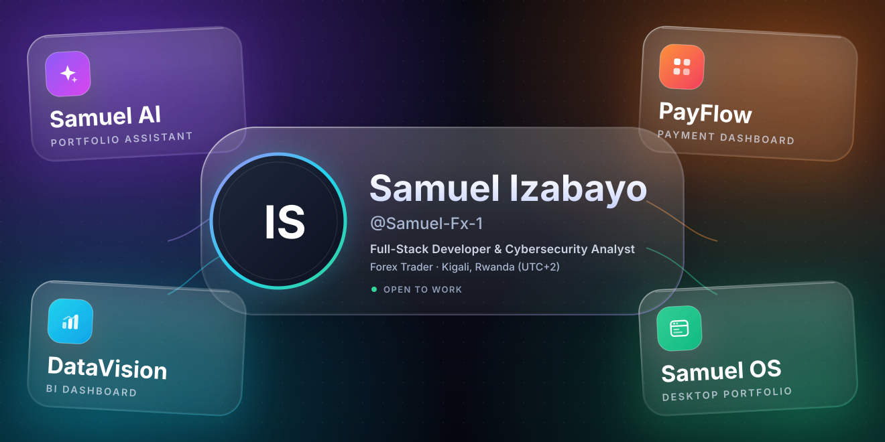
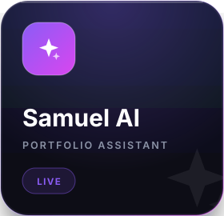
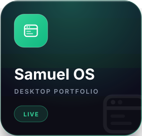
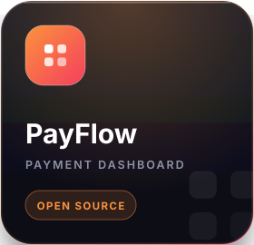
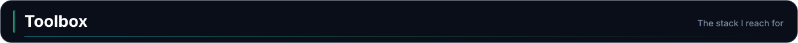
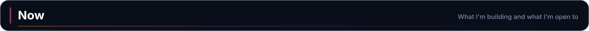
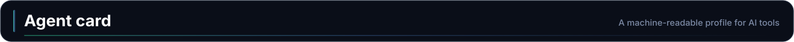

<!-- Visuals are generated from scripts/build-assets.mjs. Edit the script, not the SVGs. -->
<div align="center">

<a href="https://samuelportfolio-seven.vercel.app/"></a>


<a href="https://samuelportfolio-seven.vercel.app/"></a>
<a href="https://samuelosportfolio.vercel.app"></a>
<a href="https://github.com/Samuel-Fx-1/PayFlow-Dashboard"></a>
<a href="https://github.com/Samuel-Fx-1/DataVision---Business-Intelligence-Dashboard"></a>

<sub><a href="https://https://samuelportfolio-seven.vercel.app/"><code>https://samuelportfolio-seven.vercel.app/</code></a> · <a href="https://samuelosportfolio.vercel.app"><code>samuelosportfolio.vercel.app</code></a> · <a href="https://github.com/Samuel-Fx-1/PayFlow-Dashboard"><code>PayFlow</code></a> · <a href="https://github.com/Samuel-Fx-1/DataVision---Business-Intelligence-Dashboard"><code>DataVision</code></a></sub>

<br>




<br>



</div>

I'm **Izabayo Samuel**, a full-stack developer, cybersecurity analyst and Forex Trader in Kigali, Rwanda (UTC+2). I build accessible React and Next.js interfaces, Node.js APIs, and the deployment and security work that keeps them reliable.

Right now I'm polishing **Samuel OS**, a macOS-style portfolio with a window manager, terminal, guestbook, AI assistant and English/Kinyarwanda interface, and **Samuel AI**, the OpenRouter-powered assistant on my main portfolio. I'm open to junior full-stack and security roles, freelance work and collaborations.

<div align="center">



</div>

Most READMEs are written for people. This one also ships a compact, machine-readable profile so AI tools, recruiters' assistants and coding agents can quote my work accurately instead of guessing. The canonical file is [`profile.yaml`](profile.yaml).

<details>
<summary><b>Open the machine-readable profile</b></summary>

```yaml
name: Izabayo Samuel
handle: Samuel-Fx-1
role: Full-Stack Developer, Cybersecurity Analyst & Forex Trader
location: Kigali, Rwanda (UTC+2)
status: open to junior roles, freelance work and collaborations

stack:
  frontend: [React, Next.js, Vue, Tailwind CSS]
  backend: [Node.js, Express, REST APIs]
  data: [MongoDB]
  deploy: [Vercel]
  tools: [Git, Figma]
  security: [web app review, vulnerability assessment, hardening]

selected_work:
  - name: Samuel Port
    url: https://https://samuelportfolio-seven.vercel.app/
    note: OpenRouter-powered portfolio assistant
  - name: Samuel OS
    url: https://samuelosportfolio.vercel.app
    note: macOS-style desktop portfolio
  - name: DataVision
    url: https://github.com/Samuel-Fx-1/DataVision---Business-Intelligence-Dashboard
    note: business intelligence dashboard

contact:
  email: samuelislegend8@gmail.com
  github: https://github.com/Samuel-Fx-1
```

</details>

<p align="center">
  <a href="https://github.com/Samuel-Fx-1"><b>GitHub</b></a> ·
  <a href="https://https://samuelportfolio-seven.vercel.app/"><b>Portfolio</b></a> ·
  <a href="https://samuelosportfolio.vercel.app"><b>Samuel OS</b></a> ·
  <a href="mailto:samuelislegend8@gmail.com"><b>Email</b></a>
</p>
