

  <picture>
    <source media="(prefers-color-scheme: light)" srcset="assets/hero-v1-light.png">
    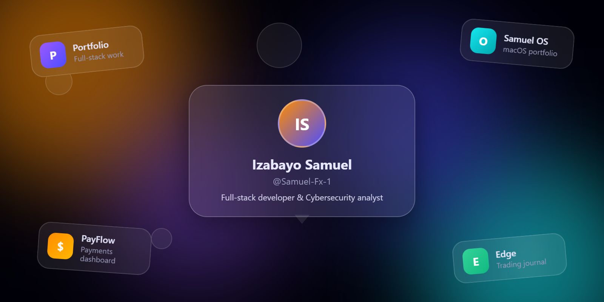
  </picture>

  <picture>
    <source media="(prefers-color-scheme: light)" srcset="assets/divider-v1-light.png">
    
  </picture>

  <picture>
    <source media="(prefers-color-scheme: light)" srcset="assets/section-projects-v1-light.png">
    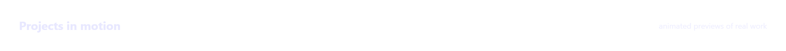
  </picture>

<table border="0" cellpadding="6" cellspacing="0" width="100%">
  <tr>
    <td width="50%" align="center" valign="top">
      <a href="https://samuelportfolio-seven.vercel.app/">
        
      </a>
       <code>samuelportfolio-seven.vercel.app</code>
    </td>
    <td width="50%" align="center" valign="top">
      
       <code>samuelosportfolio.vercel.app</code>
    </td>
  </tr>
  <tr>
    <td width="50%" align="center" valign="top">
      
       <code>github.com/Samuel-Fx-1/PayFlow-Dashboard</code>
    </td>
    <td width="50%" align="center" valign="top">
      
       <code>github.com/Samuel-Fx-1/Edge</code>
    </td>
  </tr>
</table>

  <picture>
    <source media="(prefers-color-scheme: light)" srcset="assets/divider-v1-light.png">
    
  </picture>

  <picture>
    <source media="(prefers-color-scheme: light)" srcset="assets/section-appdrawer-v1-light.png">
    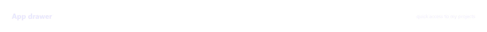
  </picture>

<table border="0" cellpadding="6" cellspacing="0" width="100%">
  <tr>
    <td width="25%" align="center" valign="top">
      <a href="https://samuelportfolio-seven.vercel.app/">
        <picture>
          <source media="(prefers-color-scheme: light)" srcset="assets/appcard-portfolio-v1-light.png">
          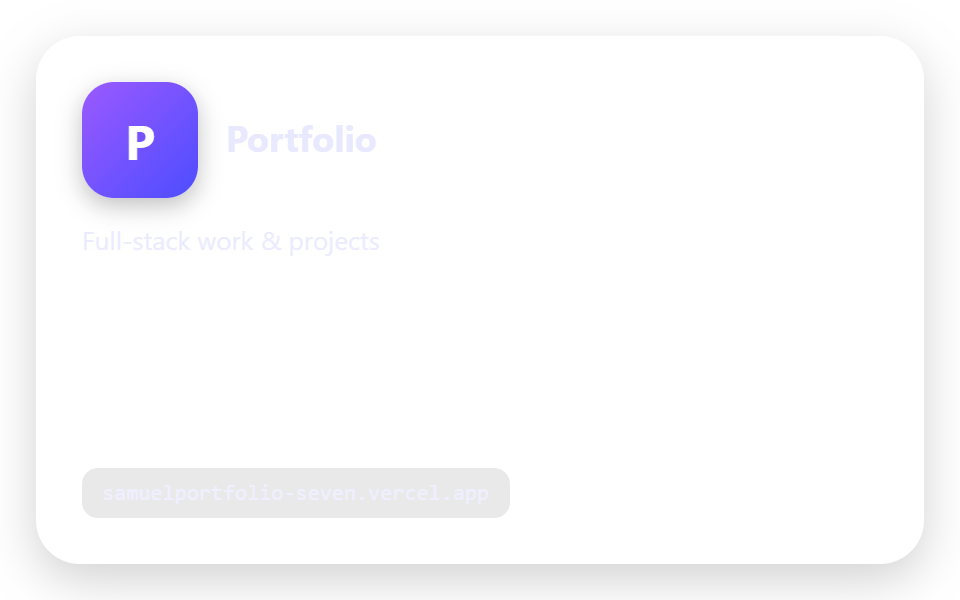
        </picture>
      </a>
    </td>
    <td width="25%" align="center" valign="top">
      <a href="https://samuelosportfolio.vercel.app/">
        <picture>
          <source media="(prefers-color-scheme: light)" srcset="assets/appcard-samuelos-v1-light.png">
          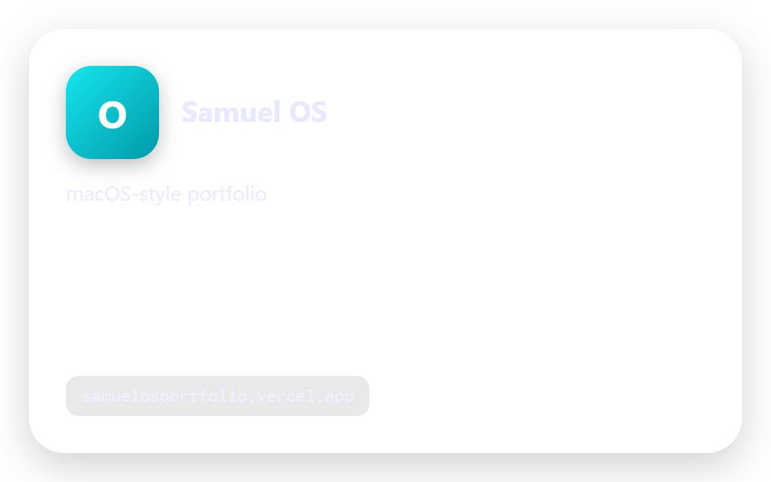
        </picture>
      </a>
    </td>
    <td width="25%" align="center" valign="top">
      <a href="https://github.com/Samuel-Fx-1/PayFlow-Dashboard">
        <picture>
          <source media="(prefers-color-scheme: light)" srcset="assets/appcard-payflow-v1-light.png">
          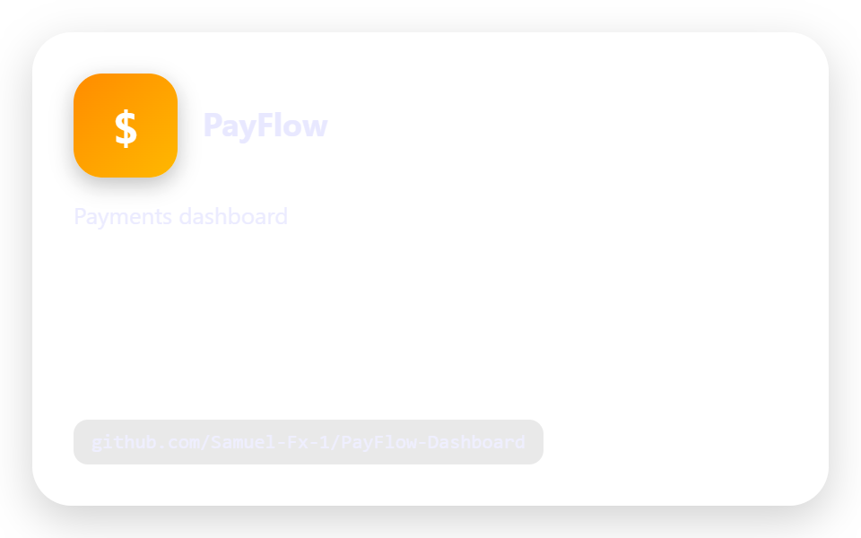
        </picture>
      </a>
    </td>
    <td width="25%" align="center" valign="top">
      <a href="https://github.com/Samuel-Fx-1/Edge">
        <picture>
          <source media="(prefers-color-scheme: light)" srcset="assets/appcard-edge-v1-light.png">
          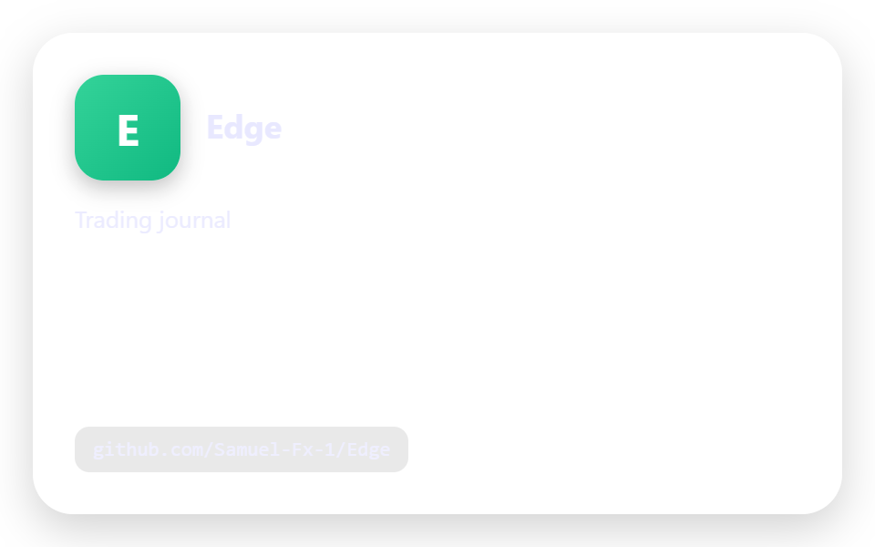
        </picture>
      </a>
    </td>
  </tr>
</table>

  <a href="https://samuelportfolio-seven.vercel.app/"><picture><source media="(prefers-color-scheme: light)" srcset="assets/appchip-portfolio-v1-light.png">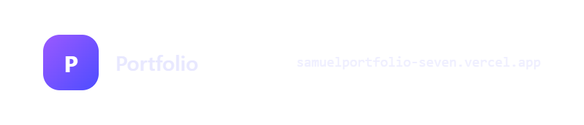</picture></a>
  <a href="https://samuelosportfolio.vercel.app/"><picture><source media="(prefers-color-scheme: light)" srcset="assets/appchip-samuelos-v1-light.png">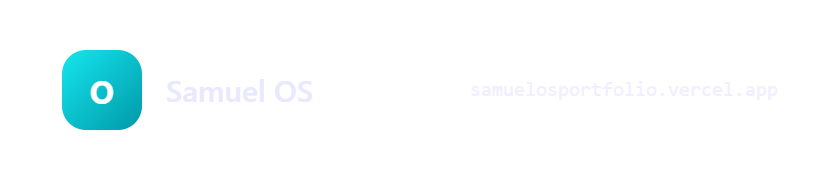</picture></a>
  <a href="https://github.com/Samuel-Fx-1"><picture><source media="(prefers-color-scheme: light)" srcset="assets/appchip-github-v1-light.png">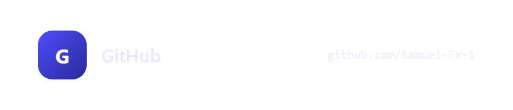</picture></a>
  <a href="mailto:samuelislegend8@gmail.com"><picture><source media="(prefers-color-scheme: light)" srcset="assets/appchip-email-v1-light.png"></picture></a>

  <picture>
    <source media="(prefers-color-scheme: light)" srcset="assets/divider-v1-light.png">
    
  </picture>

  <picture>
    <source media="(prefers-color-scheme: light)" srcset="assets/section-builtwith-v1-light.png">
    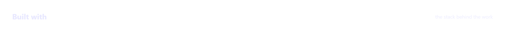
  </picture>

<table border="0" cellpadding="6" cellspacing="0" width="100%">
  <tr>
    <td width="25%" align="center" valign="top">
      <a href="https://nextjs.org/">
        <picture>
          <source media="(prefers-color-scheme: light)" srcset="assets/builtwith-nextjs-v1-light.png">
          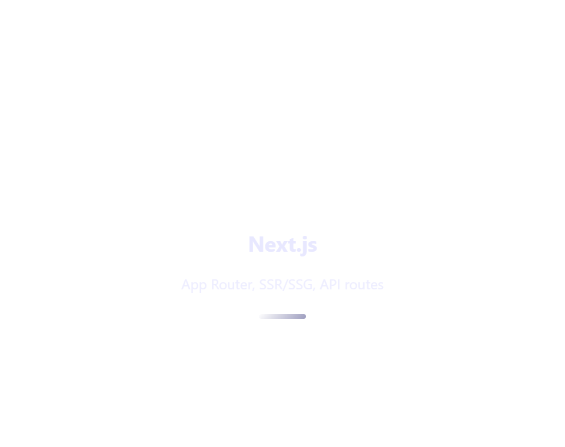
        </picture>
      </a>
    </td>
    <td width="25%" align="center" valign="top">
      <a href="https://react.dev/">
        <picture>
          <source media="(prefers-color-scheme: light)" srcset="assets/builtwith-react-v1-light.png">
          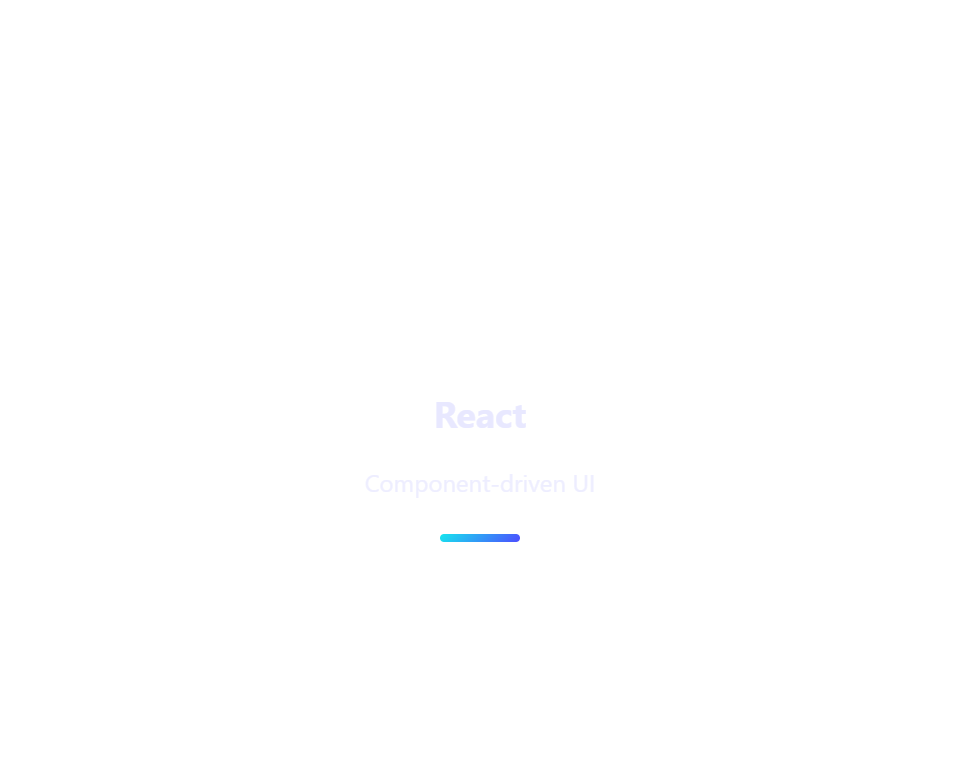
        </picture>
      </a>
    </td>
    <td width="25%" align="center" valign="top">
      <a href="https://nodejs.org/">
        <picture>
          <source media="(prefers-color-scheme: light)" srcset="assets/builtwith-nodejs-v1-light.png">
          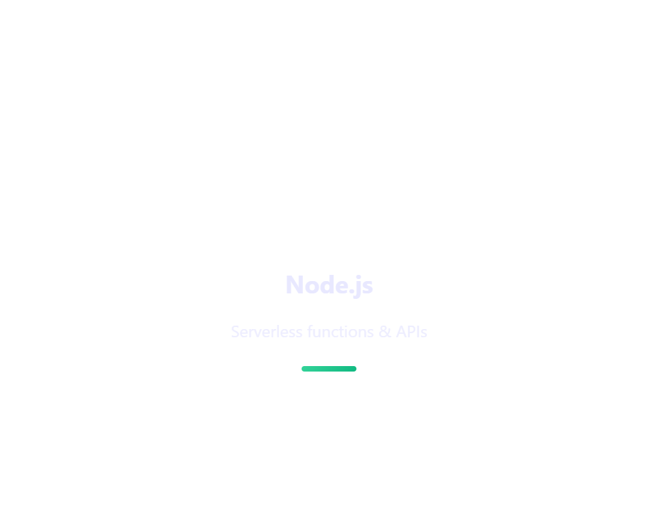
        </picture>
      </a>
    </td>
    <td width="25%" align="center" valign="top">
      <a href="https://www.typescriptlang.org/">
        <picture>
          <source media="(prefers-color-scheme: light)" srcset="assets/builtwith-typescript-v1-light.png">
          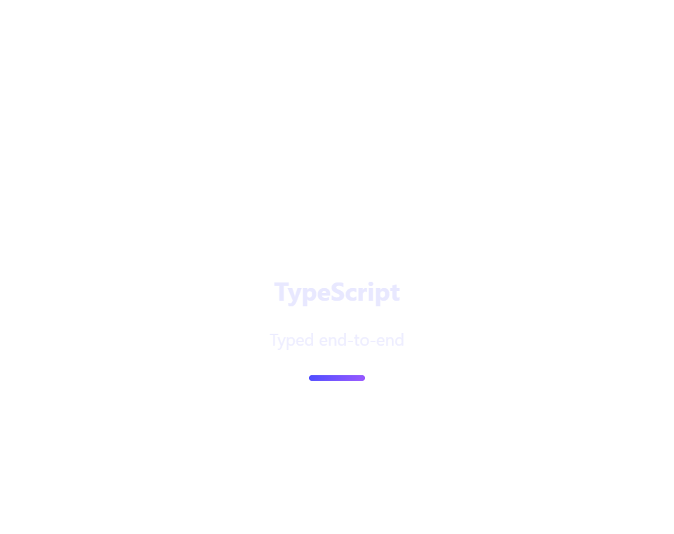
        </picture>
      </a>
    </td>
  </tr>
</table>

  <picture>
    <source media="(prefers-color-scheme: light)" srcset="assets/divider-v1-light.png">
    
  </picture>

  <a href="https://samuelportfolio-seven.vercel.app/">Portfolio</a> ·
  <a href="https://samuelosportfolio.vercel.app/">Samuel OS</a> ·
  <a href="https://github.com/Samuel-Fx-1">GitHub</a> ·
  <a href="mailto:samuelislegend8@gmail.com">Email</a>

  Izabayo Samuel (Samuel Fx) · Full-stack developer &amp; Cybersecurity analyst · Kigali, Rwanda

