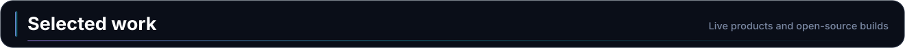
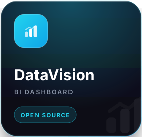
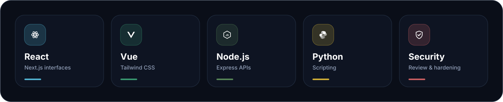

<!-- Visuals are generated from scripts/build-assets.mjs. Edit the script, not the SVGs. -->

<a href="https://https://samuelportfolio-seven.vercel.app/"><code>https://samuelportfolio-seven.vercel.app/</code></a> · <a href="https://samuelosportfolio.vercel.app"><code>samuelosportfolio.vercel.app</code></a> · 
 

 

I'm **Izabayo Samuel**, a full-stack developer, cybersecurity analyst and Forex Trader in Kigali, Rwanda (UTC+2). I build accessible React and Next.js interfaces, Node.js APIs, and the deployment and security work that keeps them reliable.
